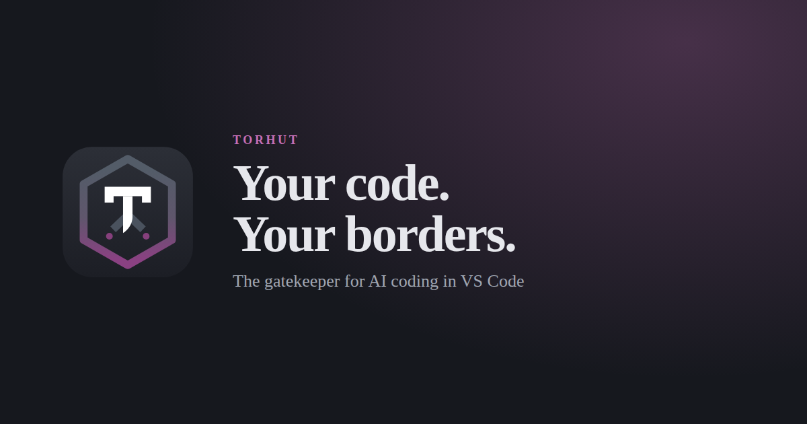
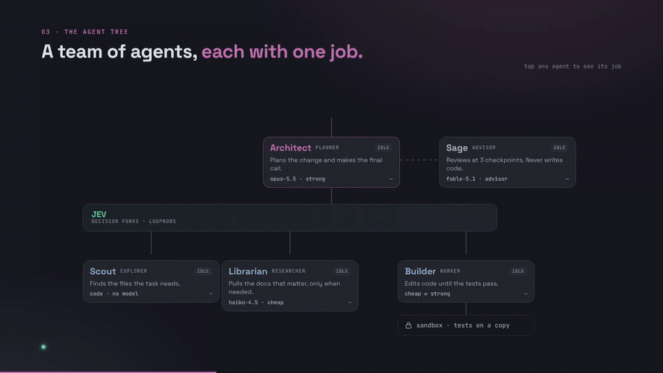
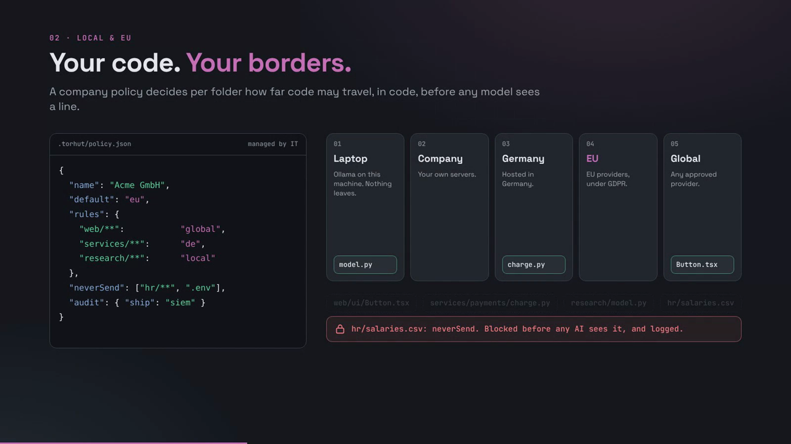
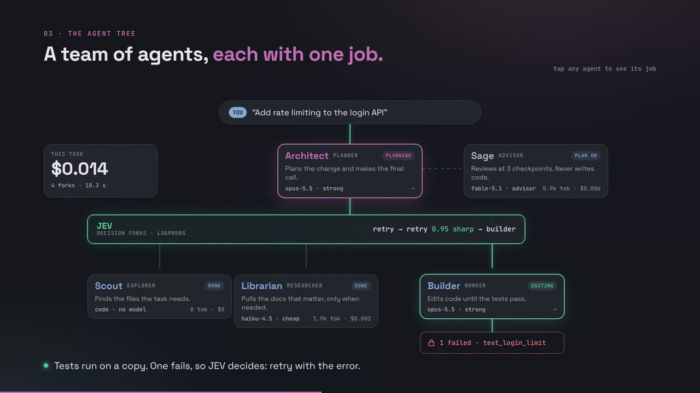
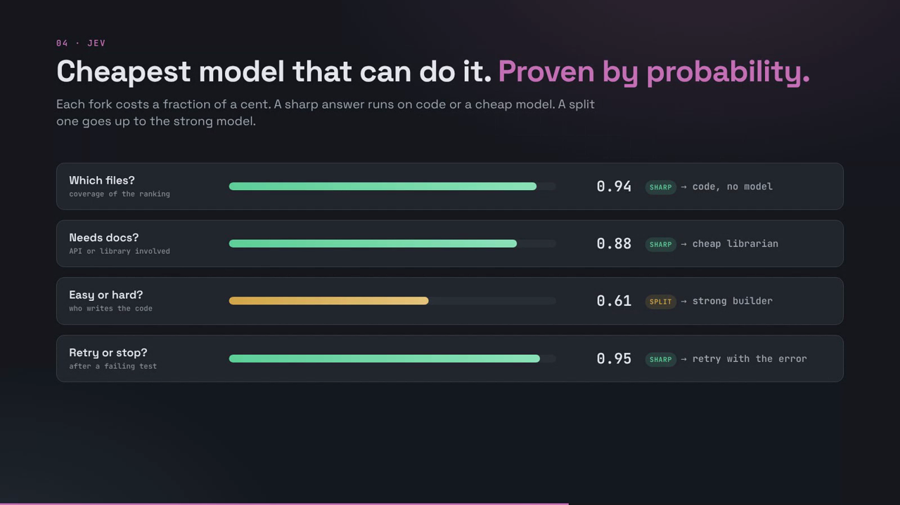
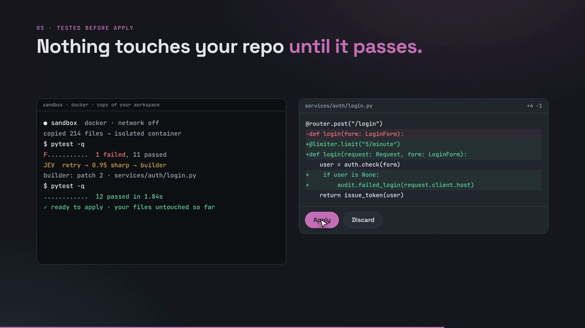
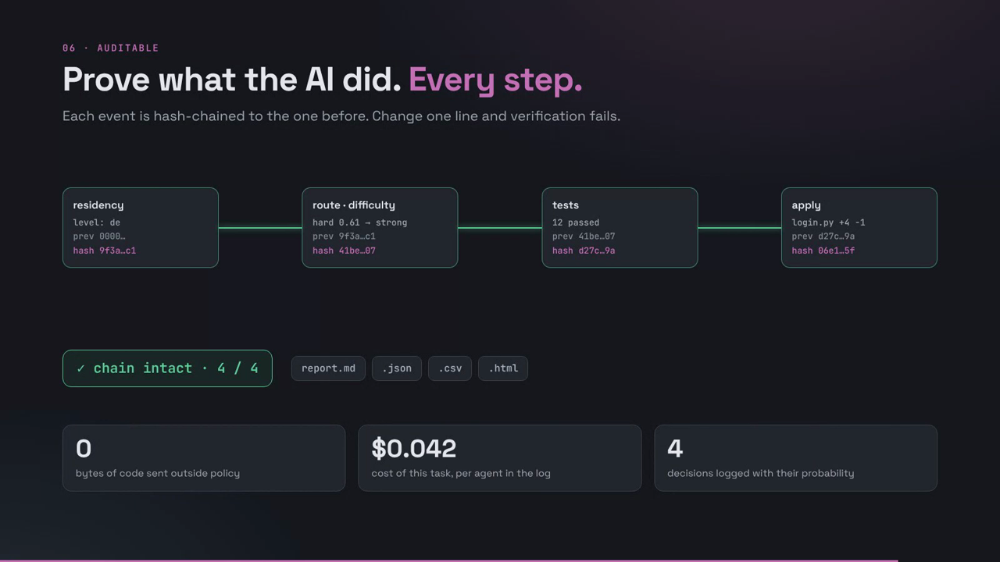

<p align="center">
  
</p>

<p align="center">
  <b>The gatekeeper for AI coding, in VS Code.</b><br>
  A strong model plans, <b>JEV</b> routes every small decision to the cheapest model that can handle it,
  an advisor checks the work, and every change is tested on a copy of your project before you click <b>Apply</b>.
</p>

<p align="center"><b>Free to use</b> · free student project, currently in beta · no telemetry, no account</p>

<p align="center">
  
</p>

## What it does

<table>
  <tr>
    <td width="50%" valign="top">
      <br>
      <b>Your data stays where you say.</b> A per-folder policy decides whether code may go to this computer,
      company servers, Germany, the EU or anywhere. Fully local with Ollama.
    </td>
    <td width="50%" valign="top">
      <br>
      <b>A team of agents, each with one job.</b> See every agent, its model and what it cost, live.
    </td>
  </tr>
  <tr>
    <td width="50%" valign="top">
      <br>
      <b>Cheapest model that can do it.</b> JEV makes every small decision with a real probability:
      sure goes cheap, unsure goes to the strong model. Cost limits per task and per month.
    </td>
    <td width="50%" valign="top">
      <br>
      <b>Tested before you apply.</b> Changes run against your tests on a copy; you see the diff and apply
      with one undoable click.
    </td>
  </tr>
  <tr>
    <td width="50%" valign="top">
      <br>
      <b>Auditable.</b> Every decision, model, cost and file sent goes into a hash-chained log you can
      verify and export (Markdown, JSON, CSV, HTML, PDF).
    </td>
    <td width="50%" valign="middle" align="center">
      <br>
      <b>Meet Huti</b>, Torhut's gatekeeper.<br>
      <sub>Calm, dry, protective: <i>"2 files stay behind the gate."</i></sub>
    </td>
  </tr>
</table>

<p align="center">
  
  
  
  
</p>

## Install

**From the VS Code Marketplace**: open Extensions (`Ctrl+Shift+X` / `Cmd+Shift+X`), search **Torhut**, click **Install**.
Cursor, VSCodium and Windsurf: the same, from Open VSX.

**From a release file**: download `torhut-<version>.vsix` from [Releases](../../releases), then in VS Code
open Extensions → `⋯` → **Install from VSIX…**, or run:

```bash
code --install-extension torhut-0.5.0.vsix
```

Check the download first (optional): compare its SHA-256 with `SHA256SUMS.txt` on the release page.

```bash
sha256sum torhut-0.5.0.vsix
```

On Windows (PowerShell): `Get-FileHash torhut-0.5.0.vsix`. On macOS: `shasum -a 256 torhut-0.5.0.vsix`.

## Requirements

- VS Code 1.90 or newer
- Python 3.9 or newer ([python.org](https://www.python.org/downloads/); on Windows tick "Add python.exe to PATH")
- An [OpenRouter](https://openrouter.ai) or Anthropic API key, or [Ollama](https://ollama.com) for fully local use.
  Without a key Torhut runs in demo mode ($0).
- Optional: Docker, to run tests in an isolated container

## First run

1. Open a project folder and click the Torhut logo in the Activity Bar.
2. Run **Torhut: Set API Key**. The key is kept in VS Code's encrypted Secret Storage.
3. **Set a spending limit on the key at your provider.** You pay the provider directly; Torhut never sees your
   bill. Its own caps ($0.50 per task, $20 per month by default) are a second line of defense.
4. Ask something in **Ask** mode, or switch to **Agent** to make a change.

## Privacy

Torhut has no server. Your code goes from your computer to the AI provider you configured, and nowhere else.
Details: [PRIVACY.md](PRIVACY.md).

## Security

Found a security problem? Please don't open a public issue; see [SECURITY.md](SECURITY.md).

## License

[Torhut Free License](LICENSE): free for personal and commercial use. The source code is not public; please
don't redistribute or resell the extension (sharing this page is always welcome). Provided as is, without
warranty: review every change before you apply it and keep your work in git.

## Feedback

Bugs and ideas: [open an issue](../../issues/new/choose).
